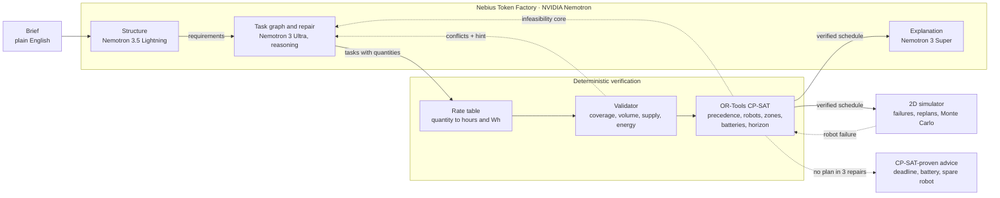

# Moonwright

**Language models propose. Solvers prove.**

Moonwright is a planning agent for crews of autonomous construction robots on the Moon. A mission
planner writes a brief in plain English. NVIDIA Nemotron models on **Nebius Token Factory** turn it
into requirements and a task graph with quantities. A deterministic validator and **OR-Tools CP-SAT**
then check the plan against the physics that matters: precedence, one task per robot, one robot per
safety zone, battery budgets including travel, material that exists before it is hauled, and the
deadline. When the solver says no, it returns a minimal infeasibility core with the numbers behind
it, and Nemotron repairs the plan from that proof. When a brief is impossible, Moonwright does not
shrink the work to pass: it says so, and the solver finds what would make it feasible
(`finishing needs 85 h, 25 h past the 60 h deadline`). A 2D simulator then breaks robots mid-mission,
CP-SAT replans the remaining work in milliseconds, and Monte Carlo puts a number on robustness.

<!-- TODO(video): hero GIF docs/img/hero.gif + links: demo video, live demo -->

## Why

A robot crew on the Moon works 1.3 light-seconds from Earth: nobody teleoperates an excavator
through that, and nobody on Earth can catch a bad plan in time. The plan has to be right before
execution and repaired autonomously when reality diverges. Language models write plans that look
right and quietly break what matters: a battery that runs dry halfway through a dig, two robots in
one blast zone, a haul scheduled before the material is dug, a deadline no schedule can meet.
Solvers catch all of that, but someone has to write the model. Moonwright puts each where it is
strong: Nemotron reads the brief, decomposes the work and repairs it; CP-SAT proves it.

The same loop fits autonomous earthmoving on Earth, where a fleet of electric machines shares
batteries, exclusion zones and a hard handover date.

## How it works



1. **Structure.** Nemotron 3.5 Lightning turns the brief into requirements: site and safety zones,
   structures with their dimensions and the operations the brief asks for, robots with batteries,
   the deadline. The requirements card is editable; the planner only ever sees the card.
2. **Task graph.** Nemotron 3 Ultra (reasoning on) proposes tasks with a robot type, zone,
   precedence and a quantity (`126 m3 = pi * (10 m)^2 * 0.4 m`). A rate table turns quantities into
   hours and Wh, so a plan cannot be made feasible by shrinking numbers.
3. **Validate.** A deterministic validator checks references, cycles, robot capability, coverage of
   every operation the brief asks for, planned volume against the structure's dimensions (a 20 m pad
   dug as a 12 m one is a conflict), that every haul waits for the digs that supply its material,
   and battery budgets with travel.
4. **Schedule.** CP-SAT minimises the makespan with one interval per task and robot, no-overlap per
   robot and per safety zone, battery budgets per robot and the deadline. If it is infeasible, every
   constraint group sits behind an assumption literal, so the solver returns a minimal core:
   `energy:EX1`, `precedence:T4->T2`, `horizon`, with a hint in numbers.
5. **Repair.** The core, the hint and the previous graph go back to Nemotron. Up to three rounds;
   every accepted repair carries a diff (added, removed, renumbered and changed tasks, scope drift
   in %), so a re-scope is visible instead of silent.
6. **Advise.** If no repair verifies, CP-SAT tries single changes on the last graph and returns only
   the ones it can prove: a later deadline, a bigger battery, one more robot.
7. **Simulate and replan.** The verified schedule runs in a 2D simulator that moves robots, drains
   batteries and injects failures. CP-SAT reschedules the remaining work first (milliseconds);
   Nemotron is asked only when the remaining fleet provably cannot finish. Monte Carlo replays the
   plan 200 times with random failures and reports the probability of finishing on time, with a
   95 % interval, and the robots the plan cannot afford to lose.

Details, edge cases and the reasoning behind each rule: [docs/design.md](docs/design.md).

## Nemotron on Nebius Token Factory

| Role | Model | Why this model |
| --- | --- | --- |
| Structure the brief | `nvidia/Nemotron-3_5-Lightning`, reasoning off | short, frequent, schema-bound; 3 s median, a fraction of a cent |
| Task graph and repair | `nvidia/Nemotron-3-Ultra-550b-a55b`, reasoning on | measured: more first-try plans, faster per token than Super, and honest on impossible briefs |
| Explanation | `nvidia/nemotron-3-super-120b-a12b` | readable summaries of a verified plan at low cost |

Every call goes through the OpenAI-compatible Token Factory API with `response_format: json_schema`
(strict) and `chat_template_kwargs.enable_thinking` per role. Reasoning and answer share
`max_tokens`, so reasoning calls start at 32,768 tokens and a cut answer is asked again at 65,536
before falling back to a direct answer. Every request is logged (status, tokens, latency, request
id, never prompt text) and summarised per model and role. Routing is one environment variable per
role (`backend/.env.example`).

## Evidence

Live runs on Token Factory, 22 test briefs of five designed kinds (comfortable, battery-split,
deadline-bound, impossible, re-scope allowed; the arithmetic of each is in
[docs/eval-briefs.md](docs/eval-briefs.md)), three repeats, both model arms on the same
requirements. Every run's plan is saved in the repository.

| Nemotron 3 Ultra, 66 live runs | Run 1 | Run 2 |
| --- | --- | --- |
| Ended with a CP-SAT-verified plan | 85 % | 85 % (74-92 %) |
| ... with the full work in scope | 45 % | 74 % (63-83 %) |
| Verified on the first graph (no repair) | 70 % | 62 % |
| Reasoning answers cut at the token limit | 78 of 190 | 4 of 121 |
| Cost per plan (median / mean) | n/a | $0.05 / $0.09 |

* **The repair loop is worth 23 points**: 62 % of runs verify on the first graph, 85 % after at most
  three repairs fed the solver's core.
* **Impossible briefs fail honestly.** On the three designed-impossible briefs, 7 of 9 Ultra runs ended
  without a plan rather than shrink the work, 6 of them with CP-SAT-proven advice. Run 1's Super
  arm had "verified" one of them 3 of 3 times by digging about half of the pad's volume; the volume check now
  refuses that.
* **Why run 2 differs from run 1**: the models had been satisfying the solver by shrinking the work
  (a 20 m pad dug as a 12 m one). Volume became a hard conflict, and "in scope" now means 95 % of
  every volume and area the brief states.
* **What run 2 could not see.** CP-SAT schedules only the precedence edges it is given, so a haul
  with no edge to its dig could start before the material existed. Rescoring run 2's saved plans
  with the supply-order check added afterwards, 17 of 56 verified Ultra plans (14 of 51 Super) did
  exactly that; the validator now rejects it and the repair loop adds the missing edges
  ([rescored rows](docs/eval/2026-10-23-live-eval-run2/eval.rescored.csv)).

Runs: [run 1](docs/eval/2026-10-23-live-eval-run1.md) (before the volume check),
[run 2](docs/eval/2026-10-23-live-eval-run2/README.md) with all 198 saved plans. Method:
[docs/design.md#evaluation](docs/design.md#evaluation).

## Run it

Offline, no API key (recorded Nemotron answers):

```bash
cd backend && uv sync
uv run moonwright plan examples/briefs/landing_pad.md --llm fixture
uv run moonwright simulate out/landing_pad.plan.json --fail EX2@30        # a robot fails at hour 30
uv run moonwright montecarlo out/landing_pad.plan.json --runs 200 --seed 1
uv run moonwright serve                                                   # API on :8000
cd ../frontend && pnpm install && pnpm dev                                # UI on :3000
```

Live: put `NEBIUS_API_KEY` in `backend/.env` (copy `backend/.env.example`), then
`uv run moonwright plan examples/briefs/landing_pad.md --llm nebius`. The UI's top bar replays
recorded runs without a backend. Commands, endpoints and settings: [docs/reference.md](docs/reference.md).
`uv run pytest` runs the backend suite (no network).

## Limitations

* **Verified means verified against the planning model**: precedence, robots, zones, battery budgets
  with the legs each robot drives, supply order and the deadline. Travel is exact for that model
  (straight lines between zone centres in whole hours, the order chosen by CP-SAT), not terrain;
  the simulator is 2D and kinematic; failures are injected, not modelled.
* **The rates are assumptions.** The rate table (`backend/moonwright/pipeline/rates.py`) uses
  illustrative low-power figures; replace them with measured ones before trusting an hour.
* **Checks only judge what the brief states.** A structure recorded without dimensions has no volume
  to judge, and a repair may still re-scope work the brief leaves open (a berm crest's width); the
  repair diff shows it.
* **Repairs can fail.** A model can answer with an unchanged graph or a re-scoped one; the evaluation
  counts these cases. Full list: [docs/design.md](docs/design.md#limitations-and-known-failures-full-list).

## Repository

```
backend/    Python 3.13 + uv: pipeline (structure, task graph, rates, validator, CP-SAT, repair loop,
            advice), simulator, replanning, Monte Carlo, CLI, FastAPI, Token Factory client, tests
frontend/   Next.js 16 UI: brief, editable requirements, streamed trace, Gantt, 2D replay, Monte Carlo
docs/       design notes, reference, evaluation runs with saved plans, eval brief arithmetic
```

## Built for

The [Nebius × NVIDIA Global AI Hackathon](https://nebiusglobalaihackathon.devpost.com/), Physical AI
track (simulation-based). Runtime calls go to Nebius Token Factory with NVIDIA Nemotron open models
(`backend/moonwright/llm/tokenfactory.py`).

## License

MIT, see [LICENSE](LICENSE).
