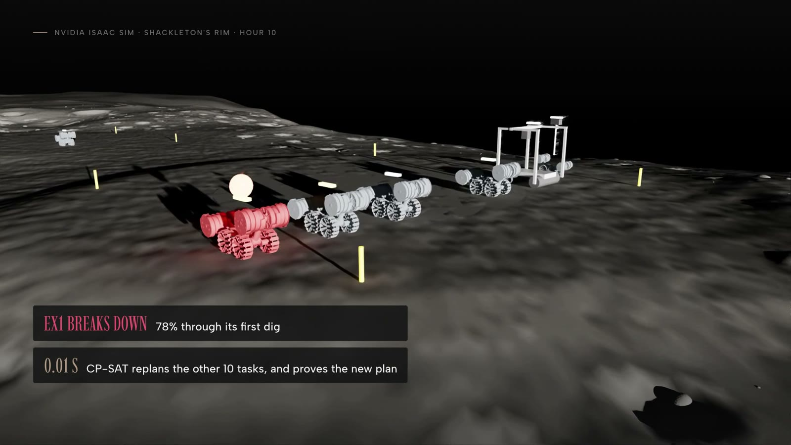
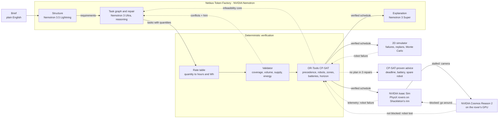

# Moonwright

**Language models propose. Solvers prove.**

Moonwright is a planning agent for crews of autonomous construction robots on the Moon. A mission
planner writes a brief in plain English. NVIDIA Nemotron models on **Nebius Token Factory** turn it
into requirements and a task graph with quantities. A deterministic validator and **OR-Tools CP-SAT**
then check the plan against the physics that matters: precedence, one task per robot, one robot per
safety zone, battery budgets including travel, material that exists before it is hauled, and the
deadline. When the solver says no, it returns a minimal infeasibility core with the numbers behind
it, and Nemotron repairs the plan from that proof. When a brief is impossible, Moonwright does not
shrink the work to pass: it says so, and the solver finds what would make it feasible
(`finishing needs 85 h, 25 h past the 60 h deadline`). A 2D simulator then breaks robots mid-mission,
CP-SAT replans the remaining work in milliseconds, and Monte Carlo puts a number on robustness. In
**NVIDIA Isaac Sim**, PhysX rovers drive a verified plan on the rim of Shackleton crater, on NASA's
measured terrain; when one breaks down, Moonwright replans from their telemetry and the rovers carry
out the new verified plan. When one stops for no reason the map shows, **NVIDIA Cosmos Reason 2**
looks through its camera: a rock means it is sound and goes around, under the same health check;
anything else means it is lost, and Moonwright replans without it.



> **Judges, start here.** The demo video (under three minutes) walks one run end to end. The site,
> **[nkm1020.github.io/moonwright](https://nkm1020.github.io/moonwright/)** (source in
> [`design/landing-1`](design/landing-1)), replays the three runs recorded live on Token Factory,
> scene by scene, with no backend and no key. To run the pipeline yourself, offline: [Run it](#run-it), a few commands and no API key;
> live on Token Factory: one environment variable. The evidence behind every figure is in
> [`docs/eval`](docs/eval).

## Why

A robot crew on the Moon works 1.3 light-seconds from Earth: nobody teleoperates an excavator
through that, and nobody on Earth can catch a bad plan in time. The plan has to be right before
execution and repaired autonomously when reality diverges. Language models write plans that look
right and quietly break what matters: a battery that runs dry halfway through a dig, two robots in
one blast zone, a haul scheduled before the material is dug, a deadline no schedule can meet.
Solvers catch all of that, but someone has to write the model. Moonwright puts each where it is
strong: Nemotron reads the brief, decomposes the work and repairs it; CP-SAT proves it.

NASA names this need. Its FY26 Civil Space Shortfall Prioritization lists shortfall SF15, "Operate
multi-agent robotic and crewed systems in cooperative planetary surface activities", with need
15.04, "Perform Earth-independent cooperative tasks on planetary bodies using autonomous software
tools in multi-agent robotic systems", and need 4.01, "Perform site preparation and bulk regolith
manipulation for infrastructure construction, including landing pads, berms, ...": the landing pad
and blast berm this demo plans ([PDF](https://www.nasa.gov/wp-content/uploads/2026/05/fy26-civil-space-shortfall-prioritization.pdf)).

The first users are study teams, not flight software. Years before a crew lands, a site-preparation
team has to decide how many machines, how much battery and how much time a pad and its berm need.
Moonwright answers each variant with a verified schedule or a proof of what is missing (a later
deadline, a bigger battery, one more robot), and Monte Carlo gives the chance of finishing on time
when robots fail: with Nemotron 3 Ultra, about a minute and a median $0.05 per plan. The next user
is the crew's own computer: the replan needs no network, so it can run on board while Nemotron
re-scopes from the ground. The same loop fits autonomous earthmoving on Earth, where a fleet of
electric machines shares batteries, exclusion zones and a hard handover date; there the rate table
comes from the machines' datasheets.

## How it works



1. **Structure.** Nemotron 3.5 Lightning turns the brief into requirements: site and safety zones,
   structures with their dimensions and the operations the brief asks for, robots with batteries,
   the deadline. The requirements card is editable; the planner only ever sees the card.
2. **Task graph.** Nemotron 3 Ultra (reasoning on) proposes tasks with a robot type, zone,
   precedence and a quantity (`126 m3 = pi * (10 m)^2 * 0.4 m`). A rate table turns quantities into
   hours and Wh, so a plan cannot be made feasible by shrinking numbers.
3. **Validate.** A deterministic validator checks references, cycles, robot capability, coverage of
   every operation the brief asks for, planned volume against the structure's dimensions (a 20 m pad
   dug as a 12 m one is a conflict), that every haul waits for the digs that supply its material,
   and battery budgets with travel.
4. **Schedule.** CP-SAT minimises the makespan with one interval per task and robot, no-overlap per
   robot and per safety zone, battery budgets per robot and the deadline. If it is infeasible, every
   constraint group sits behind an assumption literal, so the solver returns a minimal core:
   `energy:EX1`, `precedence:T4->T2`, `horizon`, with a hint in numbers.
5. **Repair.** The core, the hint and the previous graph go back to Nemotron. Up to three rounds;
   every accepted repair carries a diff (added, removed, renumbered and changed tasks, scope drift
   in %), so a re-scope is visible instead of silent.
6. **Advise.** If no repair verifies, CP-SAT tries single changes on the last graph and returns only
   the ones it can prove: a later deadline, a bigger battery, one more robot.
7. **Simulate and replan.** The verified schedule runs in a 2D simulator that moves robots, drains
   batteries and injects failures. CP-SAT reschedules the remaining work first (milliseconds);
   Nemotron is asked only when the remaining fleet provably cannot finish. Monte Carlo replays the
   plan 200 times with random failures and reports the probability of finishing on time, with a
   95 % interval, and the robots the plan cannot afford to lose.
8. **Run it on rovers.** In NVIDIA Isaac Sim 5.1, every robot of the plan is a four-wheeled PhysX
   rover (a chassis and four driven wheels) at 1.62 m/s² on Shackleton's rim (NASA LOLA's 5 m/px
   map of the south pole), steered to its work spots by the plan's schedule. When a rover breaks down, the frame the rovers report (positions,
   batteries, progress) goes to the same replanner as in step 7, and the surviving rovers carry out
   the verified schedule that comes back ([tools/isaac](tools/isaac/README.md)). A health check
   watches every drive; a rover that gains nothing for 15 minutes shows its navigation camera to
   Cosmos Reason 2-8B, which says whether something at its nose stops it. Blocked: the rover backs
   up and goes around, and a second stall marks it lost after all. Not blocked: it is lost.

Details, edge cases and the reasoning behind each rule: [docs/design.md](docs/design.md).

## Nemotron on Nebius Token Factory

| Role | Model | Why this model |
| --- | --- | --- |
| Structure the brief | `nvidia/Nemotron-3_5-Lightning`, reasoning off | short, frequent, schema-bound; 4 s median (run 4), a fraction of a cent |
| Task graph and repair | `nvidia/Nemotron-3-Ultra-550b-a55b`, reasoning on | measured: more first-try plans, faster per token than Super, and honest on impossible briefs |
| Explanation | `nvidia/nemotron-3-super-120b-a12b` | readable summaries of a verified plan at low cost |

Every call goes through the OpenAI-compatible Token Factory API with `response_format: json_schema`
(strict) and `chat_template_kwargs.enable_thinking` per role. Reasoning and answer share
`max_tokens`, so reasoning calls start at 32,768 tokens and a cut answer is asked again at 65,536
before falling back to a direct answer. Every request is logged (status, tokens, latency, request
id, never prompt text) and summarised per model and role. Routing is one environment variable per
role (`backend/.env.example`).

**Where Token Factory sped up the work.** One OpenAI-compatible endpoint served all three
Nemotron sizes, so routing each role to the model that fits it was a configuration change, not an
integration: when the measurements showed Ultra beating Super on first-try plans and on speed
(263-295 against 134-157 output tokens per second on the same prompts), the task graph moved to
Ultra in one line. Strict `json_schema` decoding on every model removed a whole class of parsing
failures, and the reasoning switch per request let the structuring calls answer directly while
the planning calls reason. That made the evaluation affordable to run four times in three days:
1,494 requests with three to five concurrent clients, zero non-200 responses and zero 429s, about
$0.05 per plan at the median. Each run found a hole in the checks
(shrunk work, hauls before digs, structuring slips), and each fix was re-measured the next day.
Details and the rough edges: [docs/feedback-draft.md](docs/feedback-draft.md).

**Cosmos Reason 2 on the rover: it proposes, physics confirms.** The same shape as the planner.
When a rover stalls, `nvidia/Cosmos-Reason2-8B` (open weights, 4-bit, 7.1 GB on the GPU beside
Isaac Sim) reads its navigation camera and proposes a cause; the rover acts on it and the physics
checks it. It is asked only what it can see (is there something at the nose the rover cannot drive
over), never told the rover has stalled: told, the models reasoned "it has not moved, so something
must be in the way", and 8B called every clear road blocked. On ten held-out camera pictures
it found 4 of 5 rocks (the fifth was out of its camera's sight) and cleared 5 of 5 drive faults;
2B found 1 rock. The same boulder in the compactor's lane, run twice: without perception the
compactor is written off and CP-SAT proves the pad cannot be finished; with it, the compactor goes
around and every task is done at hour 72 ([run and evaluation](docs/eval/2026-10-26-isaac-cosmos-ab/README.md)).
The other answer is the scene the site and the video show: a hauler's drive fails on a clear road,
Cosmos sees nothing at its nose (3 of 3, its own long shadow ignored), and CP-SAT hands its hauls to
the other hauler in 0.01 s ([run](docs/eval/2026-10-27-isaac-hl2-clear/README.md)).
GR00T and SONIC, the track's other models, are control policies for arms and humanoids; these
rovers are driven by a plain heading controller.

**On the robot.** The split is cloud planning, on-board perception and replanning: Nemotron needs
the network, Cosmos Reason and CP-SAT do not. Light takes 1.3 s each way to Earth, so the rover reads
its own camera (76 s on one RTX 4070 SUPER, 18 s of it loading the model; the mission waits) and the
solver-only replan takes a median 9 ms (p95 52 ms) on a laptop CPU (run 4); a crew's own computer
(a Jetson-class board, say) would run both. We have not measured either on a Jetson.

## Evidence

Live runs on Token Factory, 22 test briefs of five designed kinds (comfortable, battery-split,
deadline-bound, impossible, re-scope allowed; the arithmetic of each is in
[docs/eval-briefs.md](docs/eval-briefs.md)), three repeats, both model arms on the same
requirements. Every run's plan is saved in the repository, and each run was scored again with the
final checks, so the columns are judged alike.

| Nemotron 3 Ultra, 66 live runs each | Run 2 | Run 3 | Run 4 (final pipeline) |
| --- | --- | --- | --- |
| Ended with a CP-SAT-verified plan | 85 % | 89 % | 86 % (76-93 %) |
| ... with the full work in scope | 68 % | 77 % | 80 % (69-88 %) |
| ... and no haul before its material is dug | 48 % | 74 % | 80 % |
| Verified on the first graph (no repair) | 62 % | 50 % | 55 % |
| Reasoning answers cut at the token limit | 4 of 121 | 5 of 125 | 5 of 127 |
| Cost per plan (median / mean) | $0.05 / $0.09 | $0.07 / $0.10 | $0.05 / $0.10 |

* **The repair loop is worth 31 points**: in run 4, 55 % of runs verify on the first graph and 86 %
  after at most three repairs fed the solver's core.
* **The proof is what makes the repair work.** Rerun with the same code and briefs but repair
  prompts that only say "refused" (no core, no numbers), Ultra turned 9 of 28 refused first graphs
  into verified plans (32 %); with the solver's minimal core and its numeric hint, 21 of 30 (70 %;
  Fisher's exact test p = 0.008). Verified overall: 71 % against 86 %
  ([ablation](docs/eval/2026-10-24-ablation-core-vs-verdict/README.md)).
* **Impossible briefs fail honestly.** On the three designed-impossible briefs, 7 of 9 Ultra runs
  ended without a plan rather than shrink the work, 5 of them with CP-SAT-proven advice; the other
  two verified only by cutting 10-40 % of the work, which the scope row counts as out of scope.
* **Each run found what the checks could not see yet.** Run 1's plans passed by shrinking the work
  (a 20 m pad dug as a 12 m one), so volume became a hard conflict. In run 2, 17 of 56 verified
  Ultra plans hauled material before it was dug, because CP-SAT schedules only the edges it is
  given; the supply-order check made that a conflict, and none of run 4's 57 verified plans does
  it. Run 3 exposed the structuring model's slips (a smaller pad the brief allows read as the full
  one, a distance recorded as a diameter, operations the fleet cannot perform, a compaction the
  brief asks for left out); the structure stage now corrects them from the brief, and the re-scope
  brief went from 0 of 3 to 3 of 3 in scope.
* **Optimal means optimal.** Given a verified task graph, Nemotron 3 Ultra writes a valid schedule
  itself (21 of 21 passed the same independent checker), but CP-SAT with exact travel matches or
  beats every one and proves it: shorter on 5, by up to 36 h. When no schedule exists, only the
  solver can say why.
* **Robot failures are absorbed by the solver.** On run 4's plans, CP-SAT alone replanned 82 of 102
  injected failures (80 %) in a median 9 ms; the other 20 are provably beyond the surviving
  batteries, which is when Nemotron is asked to re-scope. Asked live for the first 10 of those,
  Nemotron 3 Ultra returned a CP-SAT-verified replan 8 times; twice the previous plan stayed in
  force.
* **The plan holds on PhysX rovers, and physics shows what the travel model misses.** In Isaac Sim,
  on Shackleton's rim, with excavator EX1 lost at 10 h, the rovers' telemetry went to Moonwright, CP-SAT rescheduled the
  remaining 10 tasks in 0.01 s (72 h to 79 h), and the rovers finished every task at 79 h, the same
  as the 2D simulator; none of the 6 completed drives reached its zone after the planned start. Straight
  drives matched the planner's travel time (median -0.1 %), but a rover that first had to turn
  around in place took 9.7 % longer, time the travel model does not count. That leg had 9.9 h to
  spare, but the tightest straight drive arrived with 0.025 h left, so a turn there would have made
  it late ([run](docs/eval/2026-10-25-isaac-closed-loop/README.md)).
* **What the rover sees decides whether the plan survives.** The same mission with a 1.4 m boulder in
  the lane of the site's only compactor: without perception the stall is a fault, CP-SAT proves no
  surviving robot can compact (`capability:T8`) and the mission stops at 61 h with three tasks
  undone; with Cosmos Reason 2 on its camera ("A large rock taller than the rover's wheel radius",
  3 of 3 votes), the compactor backs up, goes around and every task is done at 72.0 h. A rover
  whose drive also failed is sent around the rock, stalls again and is replanned around 15 minutes
  later ([runs](docs/eval/2026-10-26-isaac-cosmos-ab/README.md)). A hauler whose drive fails on a
  clear road is read as clear (3 of 3), replanned at once, and every task is done at 72.7 h, 0.7 h
  past the plan because the survey under way at the stall is planned in whole hours
  ([run](docs/eval/2026-10-27-isaac-hl2-clear/README.md)).

Runs: [run 1](docs/eval/2026-10-23-live-eval-run1.md) (before the volume check),
[run 2](docs/eval/2026-10-23-live-eval-run2/README.md), [run 3](docs/eval/2026-10-23-live-eval-run3/README.md),
[run 4](docs/eval/2026-10-24-live-eval-run4/README.md), the
[core-vs-verdict ablation](docs/eval/2026-10-24-ablation-core-vs-verdict/README.md), each with its saved plans. Method:
[docs/design.md#evaluation](docs/design.md#evaluation).

## Run it

Offline, no API key: the demo briefs replay live Nemotron runs recorded on Token Factory.

```bash
cd backend && uv sync
uv run moonwright plan examples/briefs/landing_pad.md --llm fixture       # two repairs, verified at 72 h
uv run moonwright plan examples/briefs/front_loaded.md --llm fixture      # no plan; CP-SAT-proven advice: 85 h
uv run moonwright simulate out/landing_pad.plan.json --fail EX1@10        # the digging robot fails at hour 10
uv run moonwright montecarlo out/landing_pad.plan.json --runs 200 --seed 1
uv run moonwright serve                                                   # API on :8000
cd ../frontend && pnpm install && pnpm dev                                # UI on :3000
```

Live: put `NEBIUS_API_KEY` in `backend/.env` (copy `backend/.env.example`), then
`uv run moonwright plan examples/briefs/landing_pad.md --llm nebius`. The UI's top bar replays
recorded runs without a backend. Commands, endpoints and settings: [docs/reference.md](docs/reference.md).
`uv run pytest` runs the backend suite (no network).

## Limitations

* **Verified means verified against the planning model**: precedence, robots, zones, battery budgets
  with the legs each robot drives, supply order and the deadline. Travel is exact for that model
  (straight lines between zone centres in whole hours, the order chosen by CP-SAT), not terrain or
  turning in place, which Isaac Sim shows can add 10 % to a leg; the 2D simulator is kinematic; in
  Isaac Sim the driving is PhysX but the work (digging, hauling, sintering) is not simulated
  physically; failures are injected, not modelled.
* **Perception is measured on rendered pictures.** Cosmos Reason 2 was evaluated on Isaac Sim
  renders of one site (10 held-out pictures, rocks 1.2 to 1.6 m), not on real cameras with dust and
  glare; it took five tries of the question to get there, all in the evaluation's README.
* **The rates are assumptions.** The rate table (`backend/moonwright/pipeline/rates.py`) uses
  illustrative low-power figures; replace them with measured ones before trusting an hour.
* **Checks only judge what the brief states.** A structure recorded without dimensions has no volume
  to judge, and a repair may still re-scope work the brief leaves open (a berm crest's width); the
  repair diff shows it.
* **Repairs can fail.** A model can answer with an unchanged graph or a re-scoped one; the evaluation
  counts these cases. Full list: [docs/design.md](docs/design.md#limitations-and-known-failures-full-list).

## Repository

```
backend/    Python 3.13 + uv: pipeline (structure, task graph, rates, validator, CP-SAT, repair loop,
            advice), simulator, replanning, Monte Carlo, CLI, FastAPI, Token Factory client, tests
frontend/   Next.js 16 UI: brief, editable requirements, streamed trace, Gantt, 2D replay, Monte Carlo
tools/isaac NVIDIA Isaac Sim 5.1: PhysX rover mission, replan bridge to the backend, Cosmos Reason 2
            perception and its evaluation, RTX render
tools/video the demo video pipeline: Playwright capture, narration, facts checked against the runs
docs/       design notes, reference, evaluation runs with saved plans, eval brief arithmetic
```

## Built for

The [Nebius × NVIDIA Global AI Hackathon](https://nebiusglobalaihackathon.devpost.com/), Physical AI
track (simulation-based). Runtime calls go to Nebius Token Factory with NVIDIA Nemotron open models
(`backend/moonwright/llm/tokenfactory.py`); the rovers run in NVIDIA Isaac Sim 5.1 (PhysX, RTX) and
see with NVIDIA Cosmos Reason 2.

## License

MIT, see [LICENSE](LICENSE).
